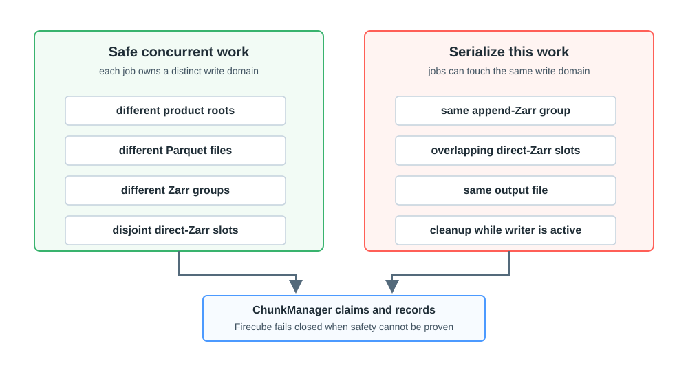

# Scheduling And Write Safety

The external orchestrator decides what starts at the same time. Firecube
enforces write safety inside each command with ChunkManager records and write
claims.

The scheduling question is always the same: do these commands write different
parts of the product, or can they touch the same write domain?

<figure markdown="span">
  { width="860" }
  <figcaption markdown="span">Concurrent work is safe only when each writer owns a distinct write domain. If the external orchestrator cannot prove that, serialize the commands.</figcaption>
</figure>

## Safe Concurrent Work

These can run concurrently when each job owns a distinct write domain:

- different product roots;
- different Parquet output files or partitions;
- different Zarr groups when the plugin and write strategy allow it;
- disjoint, chunk-aligned `DirectZarrIngestor` slot ranges.

## Work To Serialize

Run these sequentially:

- two append-Zarr writers mutating the same group;
- overlapping direct-Zarr slot ranges;
- two jobs writing the same output file;
- cleanup, claim clearing, or span deletion while a writer is still active.

For append-Zarr products, source dates alone do not prove safety. If two jobs
append to the same Zarr group, they still share the write domain.

## What Firecube Does

Firecube fails closed when it sees unsafe state. It blocks active conflicting
runs, rejects overlapping or chunk-misaligned direct-Zarr slot ranges, and
requires stale claims to be handled before work continues.

The external orchestrator still has to choose the schedule. When it cannot prove
jobs are disjoint, run them sequentially.

## Exclusive Maintenance

A maintenance run takes the exclusive maintenance claim of a product to keep other Firecube writers away from it. While another owner holds the claim, the writers below refuse to start. A stale claim also blocks them.

These writers refuse:

- ingest of every kind
- preallocate, with or without coordinate arrays
- archive restore
- index rebuild
- archive create and chunk deletion

The check runs at three points. It runs when a run starts. It runs when archive create or chunk deletion takes its own maintenance claim. It also runs when a writer ensures the resolved index. A writer that loses the race for the resolved-index claim checks the exclusive claim first. It reads and writes nothing before that check.

Firecube tries to record a refused ingest, preallocate or archive restore as a failed run. If it cannot write that record, it logs the error and the run stays started. A refused archive create, chunk deletion or index rebuild leaves no run. Ingest, preallocate and index rebuild raise `ProductUnderMaintenanceError`. Archive create and archive restore raise `ArchiveClaimError`. Chunk deletion raises `ManifestError`. See [Recover Runs And Claims](../../operations/chunk-manager/recover.md) for what to do.

`zarr multires` and `zarr consolidate-time-coord` check the claim once, when they start. They take no claim and record no run. `zarr consolidate-time-coord --dry-run` skips the check.

Some writers never check the claim:

- commands that a plugin adds under `firecube plugins`
- any process outside Firecube

The check runs only at run start, at maintenance admission and at index ensure. If an operator marks a run abandoned while its process still writes, the claim does not exclude that run.

A library caller that holds the claim can run archive create and chunk deletion on its own product. The caller passes its own run id as `holder_run_id`. No CLI command does this. Firecube still refuses archive restore for the holder.

## Next Steps

- **[Parallelism](../parallelism.md)** — choose workers and write domains by plugin class
- **[Run Parallel Zarr Writes](../../operations/parallel-zarr-writes.md)** — operate `DirectZarrIngestor` slot workers
- **[Recover Runs And Claims](../../operations/chunk-manager/recover.md)** — recover stuck runs or stale claims
- **[ChunkManager Operations](../../operations/chunk-manager/index.md)** — inspect runs, claims, spans, or the compact cache
