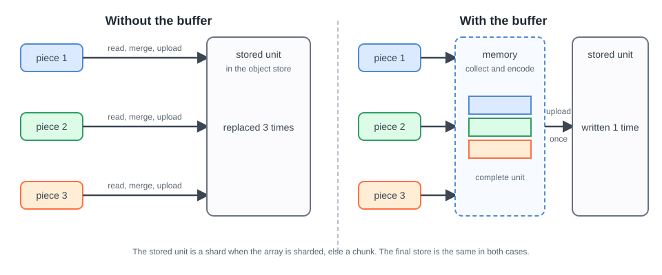
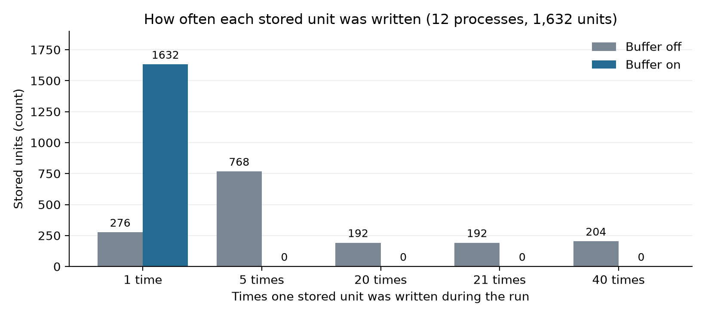
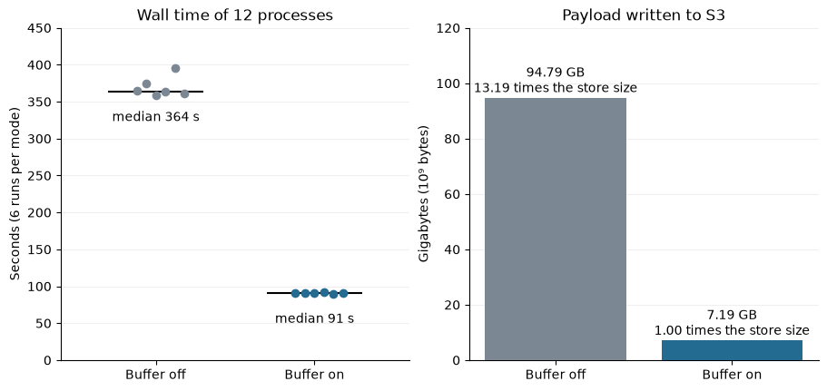
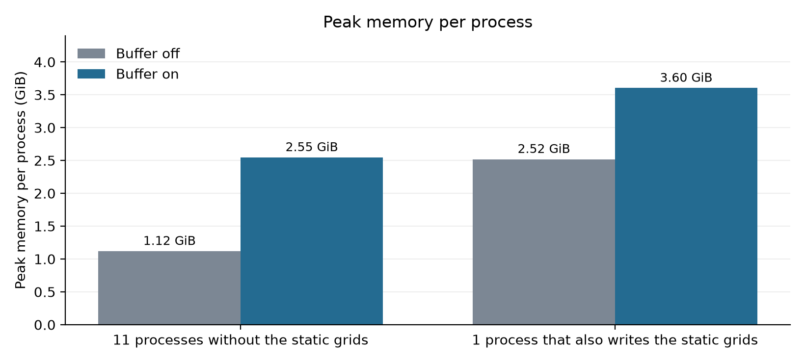

# How The Unit Write Buffer Works

The unit write buffer is an option of `DirectZarrIngestor`. It makes Firecube
write each complete stored unit once, instead of once for every piece of data
that falls into it.

<figure markdown="span">
  { width="820" }
  <figcaption markdown="span">The same three pieces reach the same stored unit. The buffer changes how many times the unit travels.</figcaption>
</figure>

## Why Pieces Are Costly

A stored unit is the part of an array that Zarr keeps as one object. It is a
shard when the array uses shards. Otherwise it is a chunk.

An object store replaces whole objects. A plugin writes data in pieces, for
example one channel or one block of rows. For each piece, Firecube reads the
stored unit back, merges the piece and uploads the whole unit again.

<figure markdown="span">
  { width="820" }
  <figcaption markdown="span">Writes per stored unit, summed over 12 processes, in one recorded run. Without the buffer the run made 20,148 payload writes. With it, 1,632.</figcaption>
</figure>

## What The Buffer Does

With `zarr_unit_write_buffer=true`, Firecube collects the pieces of one stored
unit in memory. When the run has supplied every cell of the unit, Firecube
writes the complete unit once.

Firecube builds the unit with Zarr itself. For each stored unit it creates a
scratch Zarr array in an in-memory Zarr store, the Zarr
[`MemoryStore`](https://zarr.readthedocs.io/en/stable/api/zarr/storage/#zarr.storage.MemoryStore).
The scratch array has the metadata and the codecs of the destination array.
Each piece goes into it with an ordinary Zarr array write. Zarr encodes the piece and builds the
shard, its index and the edge padding. When the unit is complete, Firecube
reads the finished object back from the memory store and uploads it once. This
is why the final store is byte-identical.

A unit that the run does not supply completely is written piece by piece, as
without the buffer. The final store is byte-identical with the option on or
off. The buffer works on one slot at a time. If the slot fails, Firecube
discards the held pieces.

## Why It Is Safe With Several Processes

The buffer replaces a whole stored unit. That is safe only when no other writer
changes the unit. A process that writes a slot window owns the whole stored
units of its window. Firecube refuses a window that covers a unit only partly,
so two processes never share a unit. The [parallel write model](parallel-writes.md)
explains this ownership.

## When It Helps

| Situation | Effect of the buffer | Why |
|---|---|---|
| Sharded layout on object storage, many pieces in each shard | Large saving | Each piece rewrote the whole shard. |
| Unsharded chunks that a plugin supplies in several pieces | Saving | Each piece rewrote the chunk. |
| Unsharded layout, each chunk written once | No change | Nothing was rewritten. |
| Fast local disk | Little or none | A rewrite costs little. |

The S3 workload below used a sharded layout. Its ratio is for that workload
only.

<figure markdown="span">
  { width="820" }
  <figcaption markdown="span">Wall time and payload written for two hours of FCI observations, 6 runs per mode. The table is in [Benchmarks](../../benchmarks.md#unit-write-buffer-sharded-s3).</figcaption>
</figure>

## What It Costs

The buffer trades memory for fewer writes. Each process holds the units of one
slot while it assembles them. For sizing, see
[Performance Tuning](../../performance.md#if-zarr-writes-are-slow).

<figure markdown="span">
  { width="820" }
  <figcaption markdown="span">Peak memory per process, as the median of 3 recorded runs. The first pair shows the largest of the 11 processes.</figcaption>
</figure>

## Limits

An array that fits no limit keeps the normal write path. The run still works
and the store is the same.

| Limit | Detail |
|---|---|
| Off by default | Set `zarr_unit_write_buffer=true`. |
| `zarr_region_write_concurrency` | Must be 1. Firecube refuses a higher value. |
| Write kind | Region writes of rank 3 or more. |
| Stored unit | One slot deep. |
| Codecs | Supported codecs only. See below. |
| Write mode | The measurements cover the direct mode only. |

### Supported Codecs

A codec is a step that encodes the bytes of a chunk or shard, for example
compression. The buffer can decode the cells it holds and encode them again. It
therefore accepts only a fixed list of codecs that give back the same bytes. An
array outside the list keeps the normal path.

The supported codecs are `bytes`, `zstd` and `crc32c`. A shard
(`sharding_indexed`) is supported when its inner codecs are on that list and
its index codecs are `bytes` then `crc32c`, the default. A typical supported
array is a sharded array with `zstd` compression:

```json
"codecs": [
  {"name": "sharding_indexed", "configuration": {
    "chunk_shape": [1, 50, 50],
    "codecs": [
      {"name": "bytes", "configuration": {"endian": "little"}},
      {"name": "zstd", "configuration": {"level": 3, "checksum": false}}
    ],
    "index_codecs": [
      {"name": "bytes", "configuration": {"endian": "little"}},
      {"name": "crc32c"}
    ],
    "index_location": "end"
  }}
]
```

These are not supported:

- compression with `blosc` or `gzip`
- `transpose`, which reorders the dimensions
- precision-losing numcodecs filters, such as `numcodecs.fixedscaleoffset`
- a Zarr v2 array, or an array with a storage transformer

To find the codecs of an array, read the `codecs` list in its `zarr.json`. If a
plugin declares `blosc` compression, the array does not use the buffer. Declare
`zstd` instead.

## Next Steps

- **[Benchmarks](../../benchmarks.md#unit-write-buffer-sharded-s3)** - review
  the measured workload
- **[Performance Tuning](../../performance.md#if-zarr-writes-are-slow)** - decide
  when to turn the option on
- **[Unit Write Buffer: MTG FCI L1C To S3](../../../showcase/unit-write-buffer.ipynb)** -
  reproduce the measurement
- **[How Parallel Zarr Writes Stay Safe](parallel-writes.md)** - see how
  processes own separate stored units
- **[Zarr](index.md)** - compare the Zarr write models
