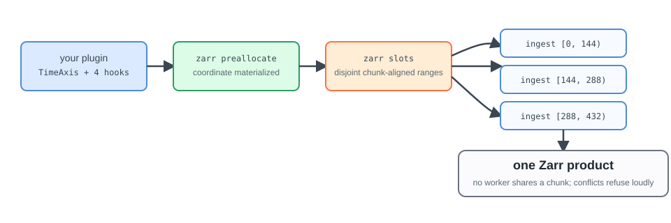

# Run Parallel Zarr Writes

Use this workflow to run several `DirectZarrIngestor` workers against one Zarr
product. Each worker receives a disjoint, chunk-aligned range of indexes in one
group.

Firecube plans and validates the ranges. Your scheduler starts one
`firecube ingest` process for each range.

<figure markdown="span">
  { width="900" }
  <figcaption markdown="span">The workflow at a glance: one declaration, one preallocate, one plan, N workers.</figcaption>
</figure>

## Before You Start

The plugin must:

- subclass `DirectZarrIngestor`;
- declare `index_spec(ctx)` with a regular time axis;
- implement `inspect_item(item, ctx)` to return `ItemInfo(coordinate=...)`,
  with `values=` when the schema has engine-owned arrays;
- declare the complete Zarr schema;
- map source values to deterministic indexes through the resolved index.

See the [DirectZarrIngestor guide](../guides/plugins/direct-zarr.md#implement-the-plugin)
for the plugin contract. Use [Parallelism](../concepts/parallelism.md) first if
you have not yet chosen a write model.

## 1. Preallocate The Product

Create or validate the shared schema before starting workers:

```bash
firecube zarr preallocate <plugin> \
  --target file:///data/products/my_product.zarr \
  --product-name my_product \
  --storage-type local \
  --storage-driver fsspec \
  --write-mode direct
```

The command is idempotent when the existing arrays match the declared schema.
It fails when their shape, data type, or chunk layout differs.

If the plugin declares a `TimeAxis.observed` axis, the coordinate values come
from the source data, not from the declaration. Materialize them before
starting workers by passing `--input-data` and the slot window to the same
command:

```bash
firecube zarr preallocate <plugin> \
  --target file:///data/products/my_product.zarr \
  --product-name my_product \
  --storage-type local \
  --storage-driver fsspec \
  --write-mode direct \
  --input-data file:///data/source \
  --slot-start 0 \
  --slot-end 432
```

Workers refuse to write into slots whose coordinate is still unmaterialized,
so a skipped window surfaces as a loud per-slot error, never as silent data
misplacement. `TimeAxis.grid` and `TimeAxis.explicit` axes are filled from
the declaration alone and skip this step.

For a plugin with engine-owned arrays, run preallocate with `--input-data` for
the whole product. Omit slot flags. Finish preallocation before starting
workers. If preallocation stops, rerun it before ingest. If new source slots
arrive, preallocate them before ingest.

Add `--dry-run` to inspect the resolved index without writing any files or
control-plane records:

```bash
firecube zarr preallocate <plugin> \
  --target file:///data/products/my_product.zarr \
  --product-name my_product \
  --storage-type local \
  --storage-driver fsspec \
  --write-mode direct \
  --dry-run
```

The dry-run output is the same JSON format as `firecube zarr index show -f json`.
No Zarr arrays, claim files, or index records are created.

## 2. Plan Slot Ranges

Inspect a human-readable plan before launching workers:

```bash
firecube zarr slots <plugin> \
  --target file:///data/products/my_product.zarr \
  --product-name my_product \
  --storage-type local \
  --storage-driver fsspec \
  --write-mode direct \
  --slot-size 144 \
  --format table
```

Each row contains a group and a half-open range such as `[0, 144)`. The slot
size must cover whole stored chunks or shards of every worker-written
time-indexed array. It must also cover the chunks or shards that the time
coordinate declares, and those stored in the target for every worker-written
array. If an explicit `--slot-size` would split one, the command refuses it and
names the multiple that the slot size needs. Omit `--format table` to receive
the JSON plan used by schedulers.

The command writes each range as it computes it. The number of ranges does not
change its memory use. The remaining-coverage intervals and the resolved index
stay in memory.

If a plugin declares neither chunks nor shards, and no worker-written array of
the target requires larger ranges, the command plans one range per slot. Pass
`--slot-size` to choose a larger range.

A plan of more than 100,000 ranges prints one hint on stderr. A plan of more
than 1,000,000 ranges is refused. The refusal names the range count, and the
range count and slot size of each group. It also names the smallest
`--slot-size` that gives an executable plan within the limit. If no such size exists, the refusal says so.
Use the size it names. To emit the plan anyway, add `--yes-i-really-mean-it`.
The JSON costs about 390 bytes per range, so 44 million ranges are about 17 GB.

Planning is resume-aware by default: completed ranges are excluded. Use
`--no-resume` only when the scheduler must deliberately ignore recorded
coverage and emit the full range.

The JSON plan also names one range per group as the static owner. Read it with:

```bash
firecube zarr slots <plugin> \
  --target file:///data/products/my_product.zarr \
  --product-name my_product \
  --storage-type local \
  --storage-driver fsspec \
  --write-mode direct \
  --slot-size 144 \
  --format json | jq '.groups[0].static_owner'
```

```json
{
  "slot_start": 0,
  "slot_end": 144
}
```

Use this value in step 3 so exactly one worker writes static arrays such as
latitude and longitude grids.

## 3. Start One Worker Per Range

Scale this workflow by starting more slot-assigned processes. Keep
`pipeline_workers=1` within each process so one worker owns each range.

Pass one planned range to each ingestion process:

```bash
firecube ingest <plugin> \
  --input-data file:///data/source \
  --target file:///data/products/my_product.zarr \
  --product-name my_product \
  --storage-type local \
  --storage-driver fsspec \
  --write-mode direct \
  --option pipeline_workers=1 \
  --slot-start 0 \
  --slot-end 144 \
  --slot-group <group>
```

A worker assigned `[0, 144)` owns indexes `0` through `143`. For a single-group
plugin, `--slot-group` can be omitted.

### Write Static Arrays Once

Static arrays do not move with the time axis, so by default every worker
rewrites them. To restrict them to one worker, add two flags to every worker
command, using the `static_owner` value from the plan in step 2:

```bash
firecube ingest <plugin> \
  --input-data file:///data/source \
  --target file:///data/products/my_product.zarr \
  --product-name my_product \
  --storage-type local \
  --storage-driver fsspec \
  --write-mode direct \
  --option pipeline_workers=1 \
  --slot-start 144 \
  --slot-end 288 \
  --suppress-static-emission-for-non-owner \
  --static-owner-slot-start 0
```

The worker whose `--slot-start` equals `--static-owner-slot-start` writes the
static arrays and stamps their markers. Every other worker skips them and logs
one warning per skipped write. `static_owner` holds one value per group, so
give each worker run a single `--slot-group` when owners differ between
groups.

### Derive Ranges From A Scheduler Index

An indexed scheduler can assign ranges without constructing the slot flags.
Set the task index and slot size for each process:

```bash
export JOB_COMPLETION_INDEX="0"
export FIRECUBE_SLOT_SIZE="144"

firecube ingest <plugin> \
  --input-data file:///data/source \
  --target file:///data/products/my_product.zarr \
  --product-name my_product \
  --storage-type local \
  --storage-driver fsspec \
  --write-mode direct \
  --option pipeline_workers=1 \
  --slot-group <group>
```

Task index `0` owns `[0, 144)`, index `1` owns `[144, 288)`, and so on. Explicit
`--slot-start` and `--slot-end` values take precedence over
`FIRECUBE_SLOT_START` and `FIRECUBE_SLOT_END`; those variables take precedence
over `JOB_COMPLETION_INDEX` with `FIRECUBE_SLOT_SIZE` or `--slot-size`.

## 4. Verify Worker Runs

Inspect the runs after the workers finish:

```bash
firecube chunks runs list \
  --target file:///data/products/my_product.zarr
```

Every planned range should have a completed run. If a retry remains blocked,
use [ChunkManager Operations](chunk-manager/index.md) to inspect the product's
claims.

## Chunk Ownership Refusals

Firecube refuses a slot range that splits a stored chunk or shard of an array
the workers write. It raises `ConfigurationError` before the worker writes.

Plan the ranges with `firecube zarr slots`, as in step 2. To see a refusal and
its fix, follow [Fix A Chunk Ownership Refusal](fix-chunk-ownership-refusal.md).
For the reasons, read [Chunk Ownership](../concepts/output-formats/zarr/chunk-ownership.md).
For a blocked plan, see [Recover A Blocked Plan](#recover-a-blocked-plan).

## Recover A Blocked Plan

Firecube refuses to emit or execute ranges when it cannot prove that the writes
are disjoint and chunk-aligned.

| Failure | Action |
|---|---|
| The plan reports blocked ranges | Inspect the run that recorded the coverage. Delete a span only after confirming that no worker is active. |
| Coverage cannot be read | Fix the storage, authentication, or control-plane problem. Do not use `--no-resume` as a recovery shortcut. |
| `WriteIntentRangeError` | Fix the plugin's source filtering or index mapping; it emitted a write outside the worker's range. |
| `the stored chunk shape (...) puts slots [...) in one chunk object` (`shard` for a sharded array) | The worker's range splits a stored chunk or shard. Plan ranges with `firecube zarr slots`. See [Chunk Ownership Refusals](#chunk-ownership-refusals). |
| `staged promotion replaces whole chunk objects` (`shard` for a sharded array) | The staged run does not write every cell of a unit it would promote. Write every cell of the unit in one run, or use `--write-mode direct`. |
| `engine-owned arrays [...] are not materialized` | Preallocate has not written the per-slot arrays, or stopped before it finished. Run `firecube zarr preallocate` once with `--input-data`. |
| An overlapping range is active | Wait for the other worker, or abandon it only after confirming that the run is stale. |
| Preallocation reports a schema mismatch | Use the intended target or align the plugin schema with the existing product. |

Use [ChunkManager Operations](chunk-manager/index.md) for run, claim, and span
recovery commands.

## Next Steps

- **[How Parallel Zarr Writes Stay Safe](../concepts/output-formats/zarr/parallel-writes.md)** - understand the slot safety model
- **[Slot-Based Parallelism: MTG FCI L1C](../showcase/mtg-fci-l1c-benchmarks.ipynb)** - reproduce the setup with a public plugin
- **[Scheduling And Write Safety](../concepts/orchestration/write-safety.md)** - coordinate external workers
- **[CLI Reference](../reference/cli.md)** - look up all slot and ingest flags
